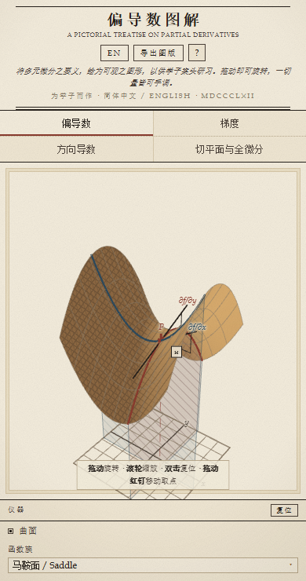
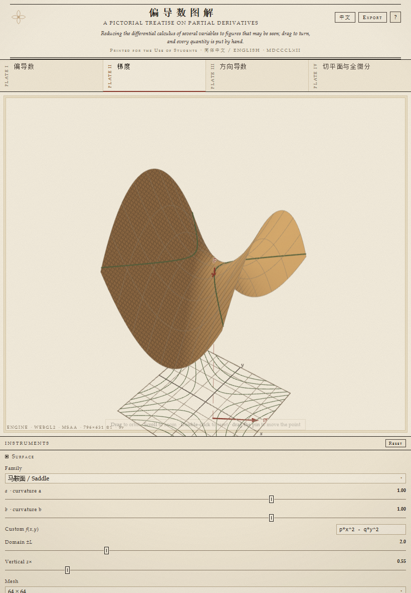
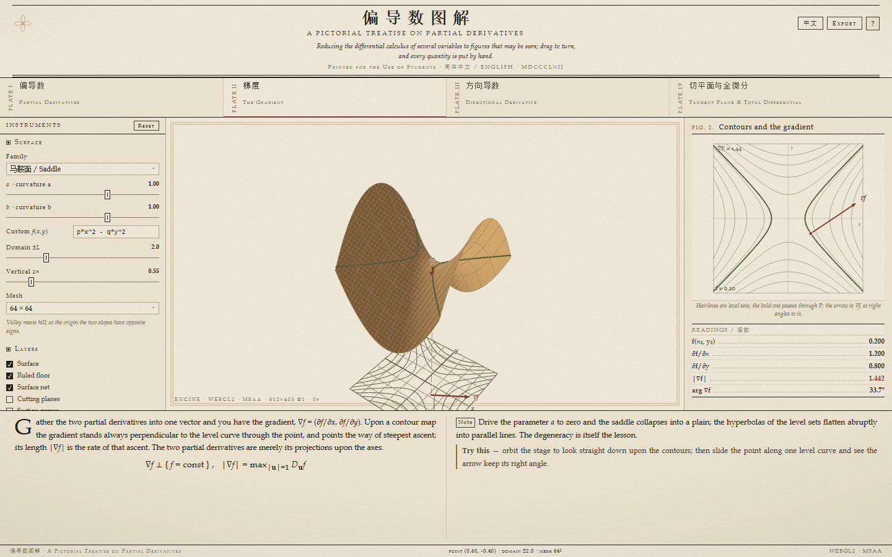
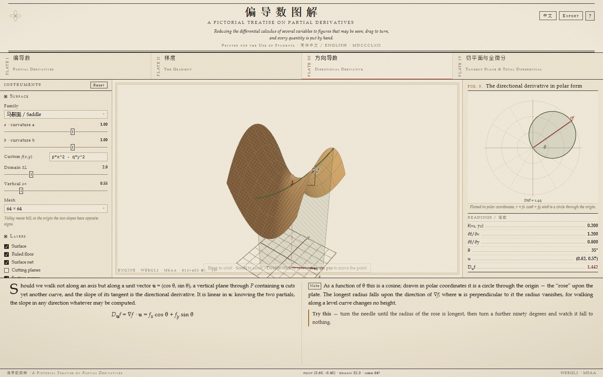
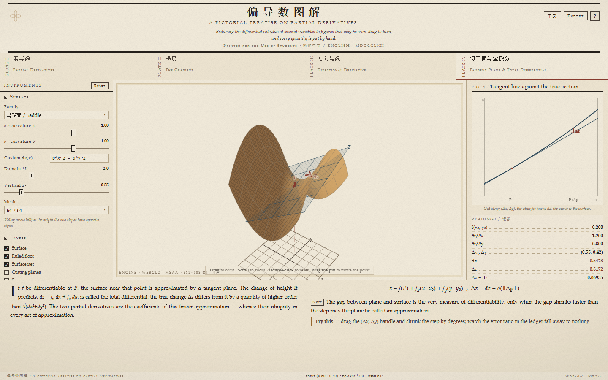
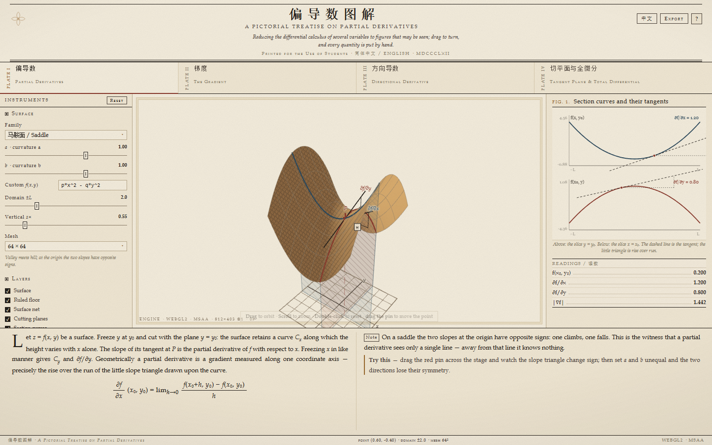

<div align="center">

# 偏导数图解

**A Pictorial Treatise on Partial Derivatives**

把可交互的多元微分讲义。


</div>

---

## 这是什么

一张可以动手的“印版”：左边是仪器面板（函数族、参数、图层、油墨、演示），中间是可旋转缩放的三维舞台，右边是同一概念的二维图解与读数表，下方是讲义正文、公式与“试一试”。

四个图章（章节）依次讲完一个主题：

| 图版 | 章节 | 讲什么 |
| :--: | --- | --- |
| I | 偏导数 · Partial Derivatives | 把 $y$ 冻结，切出截面曲线 $C_x$，切线斜率即 $\partial f/\partial x$；斜率三角在图上可直接量 |
| II | 梯度 · The Gradient | 等高线与梯度向量 $\nabla f$：恒垂直于等值线，长度即最陡上升率 |
| III | 方向导数 · Directional Derivative | 沿单位向量 $\mathbf u$ 的竖直平面截出的曲线；$D_{\mathbf u}f=\nabla f\cdot\mathbf u$ 的“玫瑰图” |
| IV | 切平面与全微分 · Tangent Plane & Total Differential | 切平面逼近 $dz=f_x\,dx+f_y\,dy$，以及平面与曲面之间那道 $o(\lVert\Delta\mathbf p\rVert)$ 的缝 |

## 特性

- **看得见的手感**：曲面用屏幕空间排线，线条在着色器里长成“粗线”，并叠了凸版纸纹、暗角与朱墨双色。
- **一切量皆可手调**：9 个函数族（马鞍、抛物、双曲抛物、波纹、高斯丘、山脊、立方鞍、墨西哥帽、自定义），自定义式支持 `sin cos tan asin acos atan sinh cosh tanh exp sqrt abs sign floor ceil round ln log log2 min max pow atan2`，参数 `p q r`。
- **双向联动**：拖舞台上的红钉改变取点 \(P\)，右栏截面图、读数表、正文标注同步更新；反过来拖 \(\Delta x,\Delta y\) 手柄可看全微分误差。
- **图层可拆**：曲面 / 底面网格 / 曲面网线 / 切割平面 / 截面曲线 / 切线斜率三角 / 等高线 / 梯度箭头 / 方向平面 / 切平面与缝隙，逐层勾选。
- **油墨三味**：铜版棕、普鲁士蓝、朱砂红，外加 12 个独立色槽。
- **导出图版**：一键把当前舞台与右栏合成为一张 PNG 存到本地。

## 操作

| 动作 | 鼠标 / 触控板 | 触屏 |
| --- | --- | --- |
| 旋转 | 拖动 | 单指拖动 |
| 缩放 | 滚轮 / 触控板双指捏合 | 双指捏合 |
| 复位视角 | 双击画面 | 双击画面 |
| 移动取点 \(P\) | 拖动红色图钉 | 拖动红色图钉 |
| 换章 | 点 PLATE 标签，或按 `1`–`4` | 点 PLATE 标签 |
| 参数摆动演示 | `空格` | 面板内勾选 |
| 中英切换 | `L` 或右上 `EN` 按钮 | 右上按钮 |
| 复位全部 | 仪器面板 `复位` | 同 |

## 屏幕适配

同一套版式在手机、平板、笔电、大屏与横屏下都能读。

- **断点**：`>1180px` 三栏原版式；`981–1180px` 两侧栏收窄；`≤980px` 改为纵向堆叠（舞台 58vh，横屏时 66vh，正文与图版顺次排下）；`≤560px` 章节标签变 2×2 网格，隐藏角落工作徽标，工具条居中。
- **触屏专项**：`pointer:coarse` 时按钮、勾选框、色板、滑块拇指放大到接近 44px；舞台提示文案换成“单指旋转 · 双指缩放 · 双击复位”；禁用长按菜单与文字选中。
- **手势**：多指 Pointer Events 跟踪，双指捏合实时改相机距离；双击（含触屏自造的 360ms 判定）复位。
- **取景按宽高比自适应**：竖屏窄视场会把相机自动后退，横竖屏切换时自动重新取景，曲面不会被裁掉。
- **跟随容器**：`ResizeObserver` 监听舞台与图版，改窗口/转屏后按新尺寸重绘（含 DPR，上限 2×）。
- **移动浏览器细节**：`100dvh` 跟随地址栏，`env(safe-area-inset-*)` 避开刘海与手势条；`prefers-reduced-motion` 下自动关掉参数摆动与视角缓转。

<div align="center">

| 手机 · 390 宽 | 平板 · 820 宽 |
| :--: | :--: |
|  |  |

</div>

## 其余图版一览

<div align="center">

| 图版 II · 等高线与梯度 | 图版 III · 方向导数 |
| :--: | :--: |
|  |  |

| 图版 IV · 切平面与全微分 | English 版式 |
| :--: | :--: |
|  |  |

</div>

## 本地运行

```bash
# 任选其一
python -m http.server 8123      # 然后打开 http://127.0.0.1:8123/
npx serve .
```

直接双击 `index.html`（`file://`）也能跑，但 WebGPU 要求安全上下文，此时会自动回退到 WebGL2 渲染。

## URL 参数

| 参数 | 作用 |
| --- | --- |
| `?ch=1..4` | 直接进入某一图版，并使用该章默认图层 |
| `?lang=zh` / `?lang=en` | 指定语言 |
| `?x=0.6&y=-0.4` | 指定取点 $P$ |
| `?selftest=1` | 跑一遍内置自检，结果写进 `data-selftest` 与徽标 |
| `?plain=1` | 关掉纸纹与暗角（截图/打印更干净） |
| `?bare=1` | 极简界面（只留舞台） |
| `?nowgpu=1` | 强制走 WebGL2 后端 |
| `?always=1` | 每帧都重绘（排查渲染问题时用） |
| `?solo=surface\|lines\|poly` | 只画其中一类几何（排查遮挡/深度问题） |

## 技术实现

- **零依赖**：没有框架、没有打包器、没有网络请求；十个原生脚本按顺序加载，全部挂在 `window.DC` 命名空间下。
- **双后端**：`js/render/webgpu.js`（WGSL，4×MSAA）优先；不可用时 `js/render/webgl2.js` 以同样的三条管线顶替（着色曲面 + 屏幕空间排线、着色器内长成的粗线、半透明平面）。`js/render/scene.js` 只产出与后端无关的类型化数组。
- **表达式**：`js/mathcore.js` 把用户输入的式子编译成 JS 闭包，只允许白名单标识符，因此不会执行任意代码；同一模块提供数值偏导与 marching squares 等高线。
- **标签排版**：三维标注（$\partial f/\partial x$、$P$、轴名）不是贴图，而是随投影位置排布的 HTML 元素，缩放窗口时自动重排。
- **自检**：`?selftest=1` 会校验矩阵、偏导、几何缓冲与后端状态，把结论写进 DOM，便可用无头浏览器抓取比对。

## 目录

```
index.html            版式与全部中英词条（正文、边注、公式）
styles/plate.css      纸纹、版框、活字、控件与四档响应式
js/i18n.js            双语切换
js/mathcore.js        表达式编译 · 数值偏导 · 等高线
js/families.js        函数族与参数定义
js/render/scene.js    矩阵、相机、采样、几何构建（后端无关）
js/render/webgpu.js   WebGPU 后端
js/render/webgl2.js   WebGL2 后端
js/render/index.js    舞台：取景、拾取、手势、标签
js/charts.js          右栏二维图版（截面、等高线、玫瑰图…）
js/ui.js              仪器面板、章节切换、导出、快捷键
js/selftest.js        内置自检
tools/                开发脚本：批量无头截图、自检结果解析
docs/                 README 用截图
```

## 已知限制

- 设备像素比上限 2×，3× 屏上笔触会略软（换取帧率）；可在 `js/render/index.js` 与 `js/charts.js` 里放宽。
- 手机竖屏时仪器面板是纵向堆叠、需要滚动，尚未做成抽屉/底部面板。
- 三维实体在舞台中约占宽度一半，超宽屏留白偏多。
- 偏导角标在取点靠近轴端时可能与轴线文字叠压；图版 III 的方向箭头与 $d_u$ 框偏小。
- 字体依赖系统栈（Bodoni / Goudy / Palatino + 宋体 / 思源宋体），未内嵌字体文件；缺字体时退化为通用衬线体，版式仍成立。
